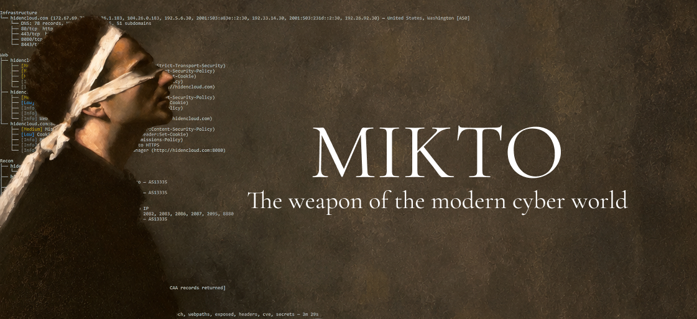
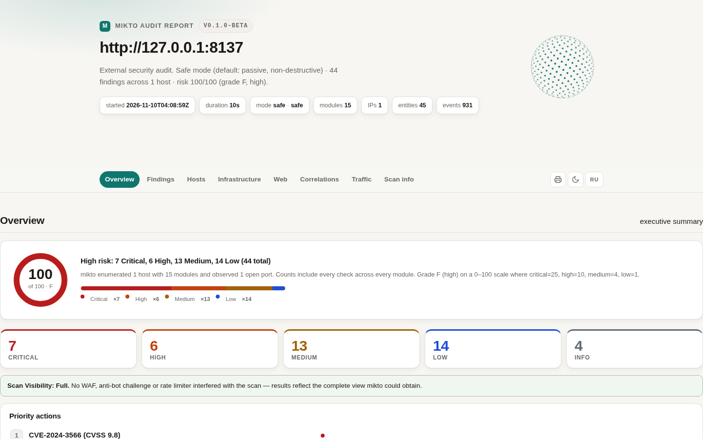
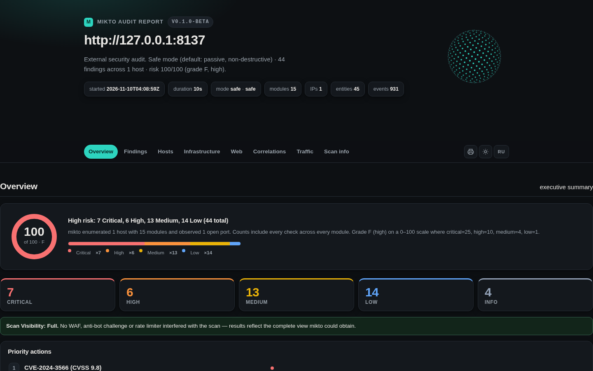
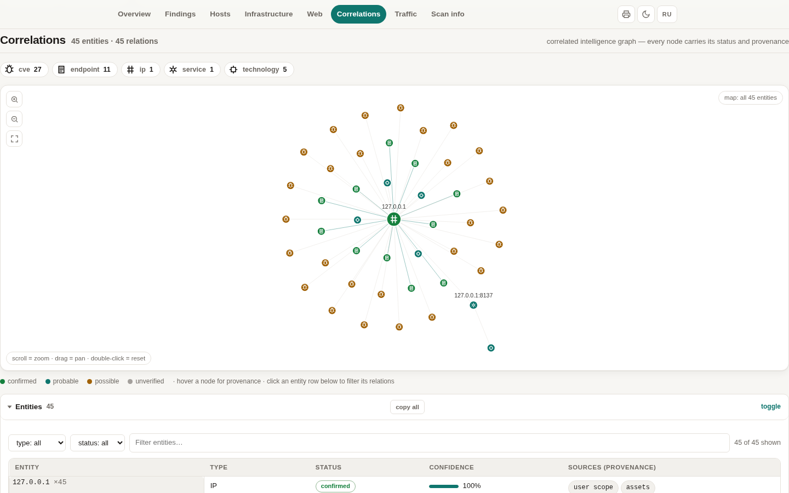
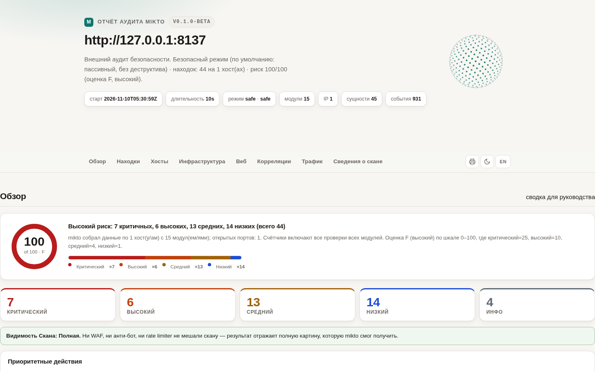
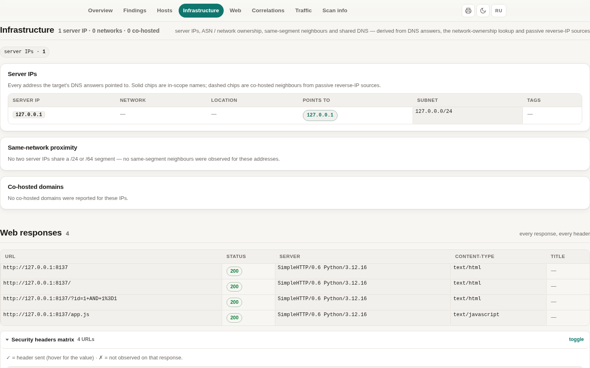
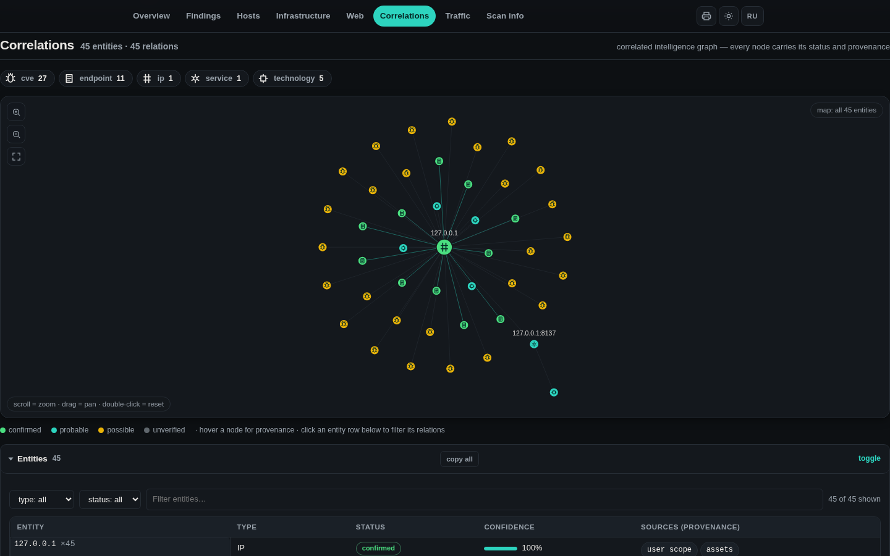

<p align="center">
  &nbsp;&nbsp;&nbsp;&nbsp;
  
</p>

<h1 align="center">mikto</h1>

<p align="center"><b>authorized-only reconnaissance &amp; audit scanner</b></p>

<p align="center">
  
  
  
  
  
  
</p>

<p align="center">
  <a href="#-quickstart">Quickstart</a> ·
  <a href="#-screenshots">Screenshots</a> ·
  <a href="#-modules">Modules</a> ·
  <a href="#-install">Install</a> ·
  <a href="#documentation">Docs</a> ·
  <a href="README.ru.md">🇷🇺 Русская версия</a>
</p>

---

`mikto` answers eight questions quickly and clearly, for targets **you are explicitly permitted to test**:

* *What is the target and its infrastructure?* — DNS, subdomains, WHOIS, server IPs, **ASN / network owner**, same-segment neighbours, co-hosted domains
* *Which services and technologies are running?* — ports with probe-ladder confidence, web stack, JS libraries, databases, panels
* *Which CVEs are actually present — and on exactly which host and service?*
* *Which services answer without authentication, and where do secrets leak?*
* *Which admin panels, debug endpoints and hidden paths exist?*
* *What public OSINT says about the target?* — certificates, archives, e-mails, reputation feeds
* *How secure is the e-mail domain?* — SPF/DMARC/DKIM/MTA-STS/TLS-RPT/DNSSEC
* *How is everything connected — and what changed since the last scan?* — intelligence graph with provenance, `mikto diff`

It **finds** issues; it never **exploits** them. No bruteforce, no payload packs, no evasion — by design.

> ### ⚠️ Ethical use — read first
>
> mikto is a **defensive auditing tool**. Run it **only** against systems you have
> **explicit, documented permission** to test (your own, or a signed engagement /
> bug-bounty scope). Unauthorized scanning is illegal in most jurisdictions.
> See [docs/RESPONSIBLE_USE.md](docs/RESPONSIBLE_USE.md).
>
> Aggressive behaviour (full 65k port range, deep path probing) is gated behind
> `--deep` with a prominent warning and an explicit confirmation.

## 📸 Screenshots

| | |
|---|---|
|  |  |
| *Executive overview — risk score, grade, score composition* | *Same report in dark mode* |
|  |  |
| *Correlations — interactive entity map with icons & provenance* | *One click switches the whole report UI to Russian* |
|  |  |
| *Infrastructure — server IPs, ASN, same-segment neighbours* | *Entity map, dark theme* |

The HTML report is a **single self-contained file** — no external assets, no
network requests, works offline via `file://`, auto light/dark theme, EN/RU
interface switch, print-ready.

## 🤔 Why mikto

Most recon tools do **one** thing and hand you a raw list: a subdomain
lister, a port scanner, a path fuzzer. mikto runs **14 modules in dependency
order** and correlates everything into one picture:

* **Every claim carries provenance.** DNS answers are `confirmed`, header
  fingerprints stay `probable`, CVE matches stay `unverified` — the report
  never sells a guess as a fact.
* **Fewer false positives beats more findings.** Secrets use high-precision
  patterns only, exposed-service checks require the service to *answer*, CVE
  matching uses exact CPE versions, webpaths measures a soft-404 baseline
  before probing.
* **Honest visibility.** If a WAF or anti-bot wall degraded the scan, the
  report says so on top — an incomplete picture is never mistaken for a
  complete audit.
* **Readable in 10–15 seconds.** Console tree + executive summary; everything
  else lives in JSON / HTML / SARIF / CSV.
* **Change monitoring in one line.** `mikto diff old.json new.json` exits 1
  when the perimeter changed — drop it into cron or CI and you have watchtower
  tooling.
* **Keyless by default.** Every external source works without registration;
  optional API keys only add depth.

An honest, feature-by-feature comparison against 94 popular recon tools lives
in [docs/COMPARISON.md](docs/COMPARISON.md).

## ⚡ Quickstart

```bash
# debian/ubuntu
sudo apt install build-essential cmake libcurl4-openssl-dev libssl-dev
git clone https://github.com/mikto-scanner/mikto && cd mikto
cmake -B build -DCMAKE_BUILD_TYPE=Release
cmake --build build -j

# first scan (scan ONLY what you are allowed to)
./build/mikto scan https://your-own-site.example --html report.html
xdg-open report.html
```

Missing libcurl/OpenSSL? The configure step prints the exact install command
for your distro instead of a raw CMake error.

## 📦 Install

<details open>
<summary><b>Linux / macOS (CMake)</b></summary>

```bash
cmake -B build -DCMAKE_BUILD_TYPE=Release   # add -DMIKTO_WERROR=ON for CI-grade builds
cmake --build build -j
ctest --test-dir build                      # 152 tests / 1422 checks
sudo cmake --install build                  # optional: installs `mikto`
```

Requirements: CMake ≥ 3.16, a C++20 compiler (GCC ≥ 11 / Clang ≥ 14),
libcurl + OpenSSL dev packages. Details and troubleshooting:
[docs/BUILD.md](docs/BUILD.md).
</details>

<details>
<summary><b>Windows</b></summary>

Two supported routes — both compile the same C++20 sources:

**MSVC + vcpkg (recommended)**

```powershell
git clone https://github.com/microsoft/vcpkg && .\vcpkg\bootstrap-vcpkg.bat
git clone https://github.com/mikto-scanner/mikto && cd mikto
cmake -S . -B build -DCMAKE_BUILD_TYPE=Release `
  -DCMAKE_TOOLCHAIN_FILE=..\vcpkg\scripts\buildsystems\vcpkg.cmake
cmake --build build --config Release
.\build\Release\mikto.exe scan https://your-own-site.example --html report.html
```

(vcpkg picks up the bundled `vcpkg.json` manifest and installs curl + OpenSSL automatically.)

**MSYS2 / MinGW**

```bash
pacman -S mingw-w64-ucrt-x86_64-{gcc,cmake,curl,openssl} make
cmake -B build -DCMAKE_BUILD_TYPE=Release -G "Unix Makefiles"
cmake --build build -j
```

Windows notes: Winsock is initialized automatically, DNS uses keyless
resolvers (1.1.1.1 / 8.8.8.8) plus a `getaddrinfo` fallback, ANSI colours work
in Windows Terminal.
</details>

<details>
<summary><b>Docker</b></summary>

```bash
docker build -t mikto .
# отчёт падает в текущую папку
docker run --rm -v "$PWD:/reports" mikto scan https://your-own-site.example --html /reports/report.html

# или через compose
docker compose run --rm scan scan https://your-own-site.example --json /reports/r.json

# ежедневный мониторинг по списку целей (targets.txt) + diff
docker compose --profile watch up
```

The runtime image is minimal (libcurl + OpenSSL + ca-certificates) and runs
as an unprivileged user.
</details>

## 🚀 Usage

```bash
mikto scan https://target.example                        # safe mode, console report
mikto scan 203.0.113.10 --deep                           # full port range (asked twice)
mikto scan targets.txt --json report.json                # file of targets, one per line
mikto scan https://target.example --html report.html --severity medium
mikto scan https://target.example --modules cve,exposed,secrets,headers
mikto scan example.com --modules subdom,emails,neighbors,infra   # OSINT-only pass
mikto scan https://target.example --trace                # show the traffic log
mikto scan https://target.example --thread max           # fastest: 64 parallel workers
mikto scan example.com --sarif report.sarif --csv findings.csv
mikto modules                                            # list modules + maturity
mikto providers                                          # external sources, limits, env vars
mikto diff prev.json now.json --html diff.html           # what changed between scans
```

Targets: an IP, a hostname, `http(s)://host[:port]`, or a **file** with one
target per line (`#` comments allowed). mikto validates targets strictly and
**never expands scope on its own** — discovered subdomains and co-hosted
neighbours are *listed* in the report, never scanned.

**Speed**: every network-heavy stage (content discovery, tech fingerprinting,
headers, e-mail harvest, reverse-IP, infra enrichment, exposed-service probes)
runs on a worker pool — `--thread <n|max>` sets how many workers (default 8,
deep 48, `max` = 64). HTTP connections are keep-alive and shared between
workers, so raising threads actually raises throughput instead of paying a
fresh TCP+TLS handshake per request. If you raise the thread count, also raise
the request pace with `--rate` (default 100 req/s, deep 800); the global rate
limit always wins, so `--thread max --rate 1000` is the full-throttle
combination. Results are identical to a single-threaded run — only the wall
time shrinks.

Long scans show a live progress line on stderr:

```
[mikto] ports     tcp connect scan  ############..................  34/58  0:12
[mikto] webpaths  probing paths     ####............................  12/41  0:03
[mikto] cve       querying NVD      \ nginx 1.25.3                         0:06
```

### Console output

```
mikto v0.1.0-beta — target: target.example

Infrastructure
├── 203.0.113.10 — Linux (Ubuntu) — United States, San Francisco [AS63949]
│   └── DNS: 12 records, MX 2, NS 4, 21 subdomains
│   ├── 443/tcp   nginx 1.25.3
│   │   └── [High] CVE-2023-44487 (CVSS 7.5) [public exploit]
│   └── 27017/tcp MongoDB
│       └── [Critical] MongoDB responds without authentication
Web
├── [Medium] Missing Content-Security-Policy (header:Content-Security-Policy)
├── [Medium] WordPress admin surface: /wp-login.php (HTTP 200)
└── [Info] Web stack: WordPress 6.4.2, PHP 8.1, nginx 1.25.3, MySQL
Secrets
└── [High] AWS access key id in served content — https://target.example/app.js
Recon
├── example.com
│   ├── [Info] 7 of 21 subdomains resolve [api.example.com, dev.example.com, ...]
│   └── [Info] 3 e-mail addresses discovered [info@example.com, ...]
└── 203.0.113.10
    └── [Low] 4 other site(s) hosted on the same IP

Summary: 1 Critical 2 High 2 Medium 2 Low 3 Info (10 findings)
Modules: assets, whois, subdom, emails, ports, infra, neighbors, tech,
webpaths, exposed, headers, cve, secrets — 12.4s
```

## 🧩 Modules

Run any subset with `--modules`. Canonical run order = dependency order.

| Module      | Maturity    | What it does |
|-------------|-------------|--------------|
| `assets`    | preview     | **Full DNS reconnaissance**: A/AAAA/MX/NS/TXT/SOA/CAA via a built-in RFC 1035 client, PTR for IPs, SPF/DMARC/CAA policy checks, dangling MX/NS verification, `--deep` AXFR probe — plus TLS certificate inspection (SAN names are **reported, never scanned**). |
| `whois`     | preview     | **Registration data over TCP/43 (keyless)**: registrar, creation/expiry dates, contact e-mails, nameservers; expiry-monitoring findings. |
| `subdom`    | preview     | **Passive subdomain discovery** from public keyless sources (crt.sh, urlscan.io, Wayback Machine, HackerTarget — queried concurrently), wildcard detection, parallel resolution. Discovered hosts are **reported, never scanned**. |
| `emails`    | preview     | **E-mail harvesting** from certificate transparency and the target's public pages. Only addresses at the target's own domain. |
| `emailsec`  | preview     | **E-mail security posture** (DNS-only, passive): SPF policy quality, DMARC evaluation, DKIM selector probing (16 selectors), MTA-STS, TLS-RPT, DNSSEC, positive CAA notes. |
| `ports`     | **reference** | TCP connect scan with a **probe ladder** (banner → TLS handshake → HTTP GET → Redis PING), nmap-style service + version detection with **confidence levels**, multi-product `Server:` parsing, passive **OS guess**, and **deception analysis**: honeypot banners, proxy sinkholes, protocol-vs-port mismatches. |
| `infra`     | preview     | **Infrastructure enrichment (all keyless)**: Shodan InternetDB (ports, CPEs, CVEs, tags), **server geolocation / ASN / hosting org** (ipwho.is → ip-api fallback), **URLhaus reputation**. Optional keys: `--shodan-key`, `--censys-key` (per-service software/CPEs → cve module). |
| `neighbors` | preview     | **Co-hosted domains on the same IP** (reverse-IP lookup) + shared-hosting risk assessment. |
| `tech`      | preview     | **WhatWeb-style fingerprinting** (~150 markers): CMS, languages & frameworks, JS libraries with versions, databases, hosting panels, CDN/WAF, WordPress plugin inventory, read-only version-revealing probes, EOL runtime checks. |
| `webpaths`  | **reference** | **Universal content discovery** (GET only): mines paths from homepage HTML, string literals inside JS/CSS bundles, robots.txt and sitemap.xml, then runs two recursive combination rounds — finds unguessable surfaces like `/api/lol/admin`. Soft-404 baseline kills SPA false positives; every path records HOW it was found. |
| `exposed`   | **reference** | Detects services answering **without authentication**: Redis, Memcached, MongoDB, Elasticsearch, CouchDB, etcd, Docker API, RabbitMQ management, Kubernetes API. Strictly read-only probes. |
| `headers`   | **reference** | Security headers & cookie flags: HSTS, CSP, XCTO, clickjacking, Referrer-Policy, Permissions-Policy, CORS, version disclosure. |
| `waf`       | preview     | **Blocker detection & honest visibility assessment**: WAF/edge vendors, anti-bot challenges, rate limiters, geo/region blocks → per-host `scan_visibility` (full / degraded / blocked). One harmless probe GET — no evasion. |
| `cve`       | preview     | Matches detected versions (banners **+ web stack + databases + Shodan/Censys CPEs**) against **live NVD API 2.0** (24 h cache, self-pacing, request budget). CPE map of **75+ products**. Enriched with **public exploit links from Exploit-DB**. |
| `secrets`   | preview     | Conservative, high-precision credential patterns (AWS/Google/Slack keys, private-key blocks) in served content + up to 8 same-origin JS files. Evidence is always redacted. |

## 📄 Reports

| Flag | Format | Highlights |
|------|--------|------------|
| `--json` | JSON | fully structured, `jq`-friendly: hosts, ports, TLS, dns_records, geo, whois, tech, paths, subdomains, emails, neighbors, reputation, CPEs, **traffic**, **intelligence_graph**, **providers** |
| `--html` | HTML | single self-contained file (audit-ledger design): risk score 0–100 + grade + composition bar, top-5 priority actions, findings-by-module bars, security-headers matrix, **Correlations entity map with icons/pan/zoom**, infrastructure section (server IPs, ASN, same-segment neighbours, co-hosted domains, shared NS/MX), full traffic log, provider health, **EN/RU interface switch**, print stylesheet |
| `--sarif` | SARIF 2.1.0 | GitHub code-scanning compatible |
| `--csv` | CSV | RFC 4180 flat table for spreadsheets |
| console | text | the tree above; `--severity` filters the display only |

Every finding carries: `severity` · `location` (host, port, header or URL) ·
a short **title** · a **detail** explaining why it matters · a
**recommendation** · redacted **evidence** · references (CVE links).

## 📡 Data sources (all keyless unless noted)

| Source | Used by | Notes |
|--------|---------|-------|
| [crt.sh](https://crt.sh) | subdom, emails | public certificate-transparency logs |
| [urlscan.io](https://urlscan.io) | subdom | public scan index |
| [Wayback Machine](https://web.archive.org) | subdom | archived URL hostnames |
| HackerTarget | subdom, neighbors | free endpoint, daily quota; degrades gracefully |
| DNS (system resolvers) | assets, subdom | built-in RFC 1035 client: A/AAAA/MX/NS/TXT/SOA/CAA/PTR (+AXFR in deep) |
| WHOIS (TCP/43) | whois | IANA referral + authoritative servers, plain protocol |
| [ipwho.is](https://ipwho.is) / ip-api.com | infra | keyless IP geolocation, ASN, hosting org; 24 h cache |
| [URLhaus (abuse.ch)](https://urlhaus.abuse.ch) | infra | recent malware-URL feed, exact host/IP match; 1 h cache |
| [Exploit-DB (GitLab mirror)](https://gitlab.com/exploit-database/exploitdb) | cve | public exploit index keyed by CVE id; 24 h cache |
| [Shodan InternetDB](https://internetdb.shodan.io) | infra | free per-IP data: ports, CPEs, CVEs, tags; 24 h local cache |
| Shodan API (optional) | infra | `--shodan-key` / `SHODAN_API_KEY`: adds OS + banners |
| [Censys Search API v2](https://search.censys.io) (optional) | infra | `--censys-key API_ID:API_SECRET`: per-service software/CPEs → cve module, labels, ASN/rDNS |
| [NVD API 2.0](https://nvd.nist.gov) | cve | exact CPE match, 24 h cache; `--nvd-key` raises rate limits |
| [cvelistV5](https://github.com/CVEProject/cvelistV5) | infra | official CVE records fetched online by ID for CVSS/description enrichment |

Every external API is accounted per scan (requests, successes, failures);
5 consecutive failures open a **circuit breaker** that skips a dead source —
degradation is recorded in the report, never hidden.

## 🛡 Safe mode vs deep mode

* **safe (default)** — curated ~55-port list, 8 workers, 100 ops/s rate limit,
  1.5 s connect timeout, ~60 known paths. Polite by construction.
* **`--deep`** — full 1–65535 range, extended path list (~190 paths), AXFR
  probe. Prints a prominent warning; requires interactive confirmation or
  `--yes`. If your permission does not explicitly cover deep testing, do not
  use it.
* Deep retunes the defaults **you did not set explicitly** (48 workers,
  800 ops/s, 1.0 s timeout) — a full 65k-port sweep finishes in ≈ 80–120 s.
* Every connect, probe and HTTP request passes through one shared token-bucket
  rate limiter.

## 📚 Documentation

| Document | What's inside |
|----------|---------------|
| [docs/GETTING_STARTED.md](docs/GETTING_STARTED.md) | install, first scan, reading the report, modes |
| [docs/MODULES.md](docs/MODULES.md) | every module: what it does, what it touches, what it outputs |
| [docs/DEV_GUIDE.md](docs/DEV_GUIDE.md) | code layout, how to modify mikto, how to write your own module |
| [docs/BUILD.md](docs/BUILD.md) | CMake details, Windows (MSVC/vcpkg/MSYS2), Docker, CI |
| [docs/COMPARISON.md](docs/COMPARISON.md) | honest feature-by-feature comparison vs 94 recon tools |
| [docs/RESPONSIBLE_USE.md](docs/RESPONSIBLE_USE.md) | the ethics contract and legal notes |
| [docs/ROADMAP.md](docs/ROADMAP.md) | what is done and what is next |
| [docs/AUDIT.md](docs/AUDIT.md) | engineering audit log |
| [devlog.md](devlog.md) | полный ход сканирования, по-русски |

## 🗺 Roadmap

* **v0.2** — depth-limited web crawler feeding secrets/emails/tech; AltDNS-style
  subdomain permutations; typosquatting checks.
* **v0.3** — loadable WhatWeb-style marker packs; nuclei-compatible template
  engine (GET-only matchers).
* **v0.4** — bridges to external tools (ingest subfinder/amass/nuclei JSON into
  the unified finding model); JSON Schema for the report format.
* Not planned: bruteforce, exploitation, payload packs, auto-dumping, WAF
  evasion. mikto must remain a *finding* tool, not a *hacking* tool.

## License

MIT — see [LICENSE](LICENSE).

---

<p align="center"><i>measure first · ask permission · report honestly</i></p>
