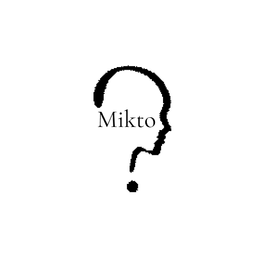
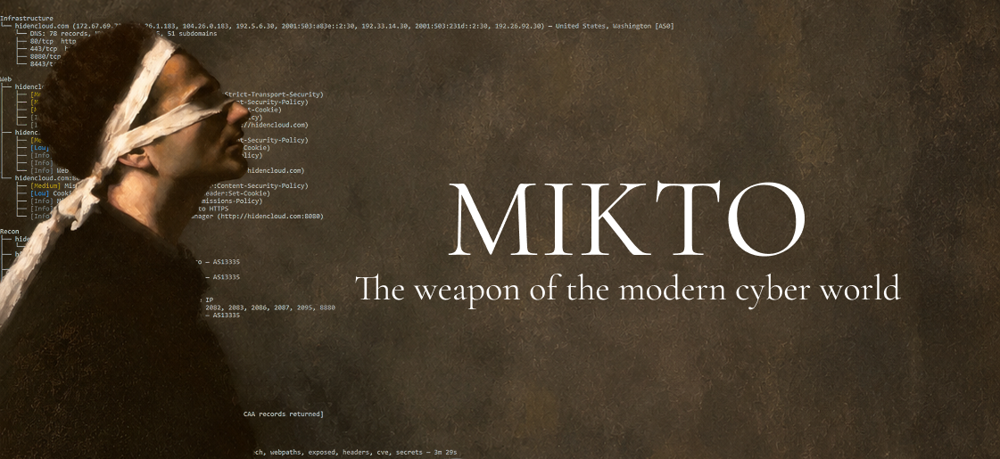
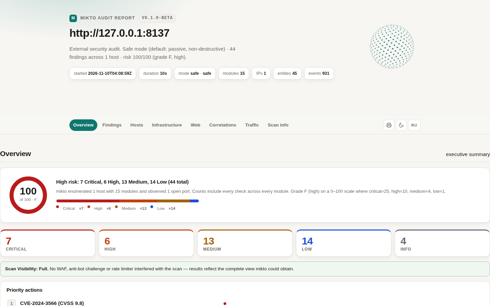
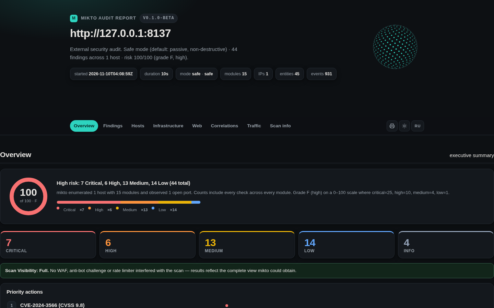
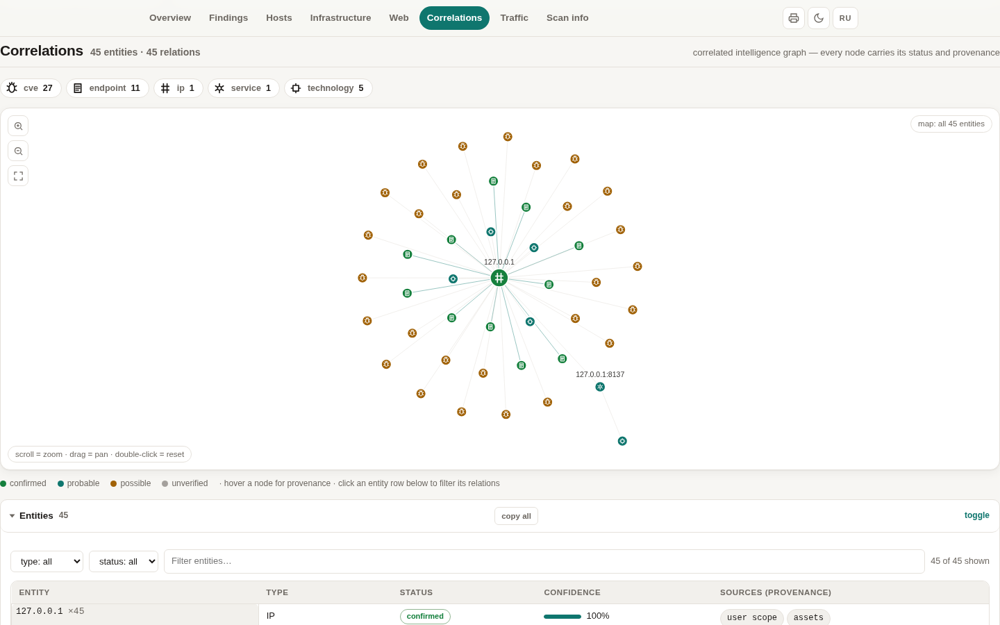
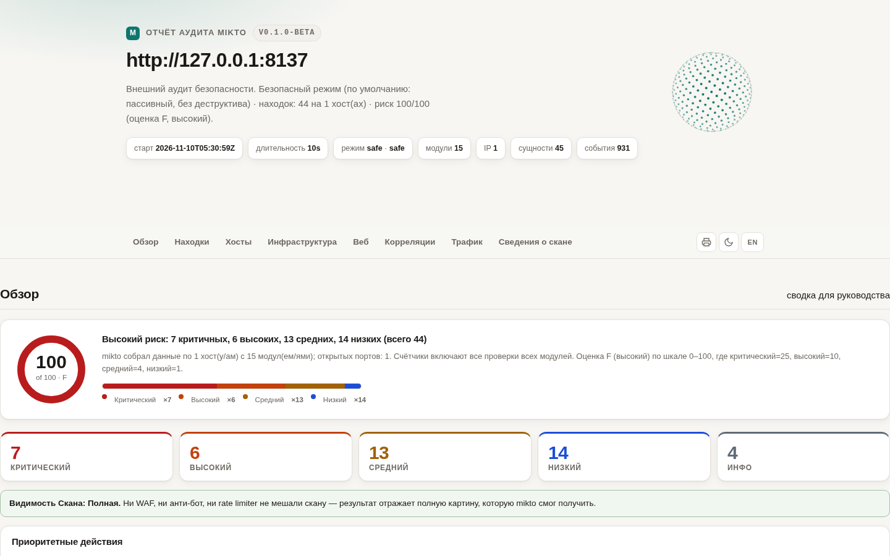
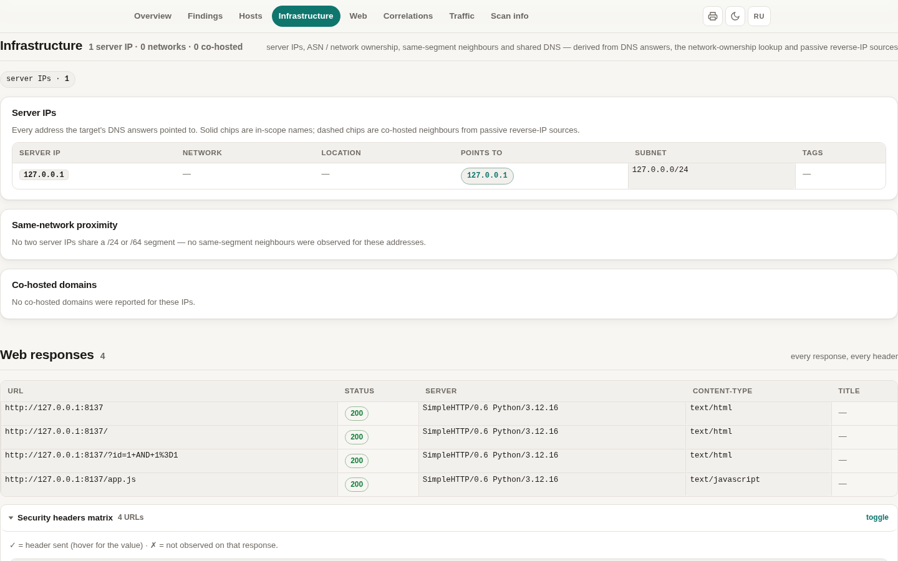
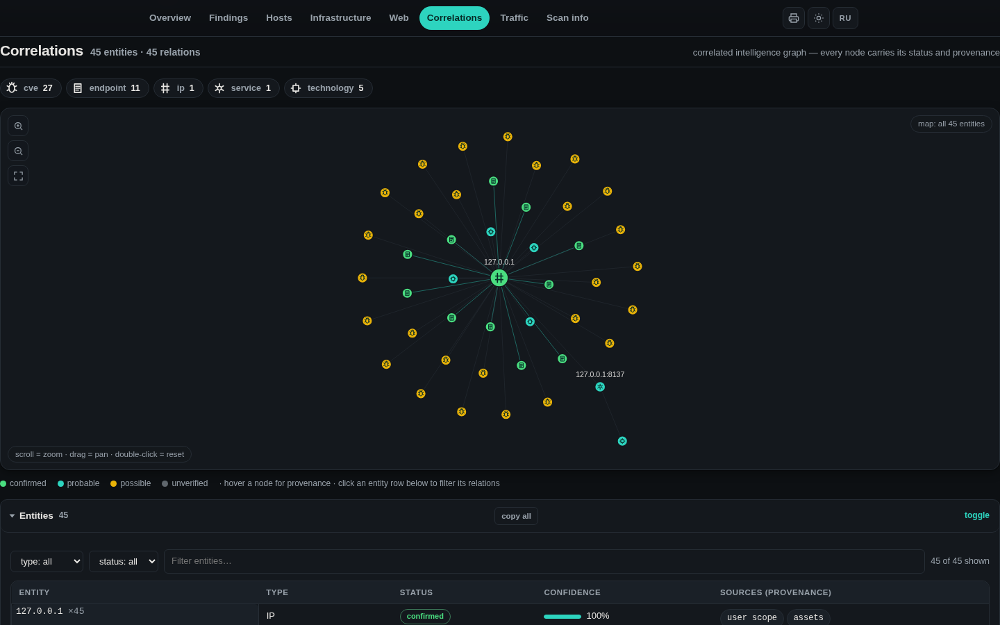

<p align="center">
  &nbsp;&nbsp;&nbsp;&nbsp;
  
</p>

<h1 align="center">mikto</h1>

<p align="center"><b>рекон и аудит — только для авторизованных целей</b></p>

<p align="center">
  
  
  
  
  
  
</p>

<p align="center">
  <a href="#-быстрый-старт">Быстрый старт</a> ·
  <a href="#-скриншоты">Скриншоты</a> ·
  <a href="#-модули">Модули</a> ·
  <a href="#-установка">Установка</a> ·
  <a href="#документация">Документация</a> ·
  <a href="README.md">🇬🇧 English</a>
</p>

---

`mikto` быстро и понятно отвечает на восемь вопросов о цели, которую вам **явно разрешили проверять**:

* *Что за цель и какая у неё инфраструктура?* — DNS, субдомены, WHOIS, серверные IP, **ASN / владелец сети**, соседи по сегменту, домены на том же IP
* *Какие сервисы и технологии крутятся?* — порты с уровнями уверенности, веб-стек, JS-библиотеки, базы, панели
* *Какие CVE реально присутствуют — и на каком именно хосте и сервисе?*
* *Какие сервисы отвечают без аутентификации, и где утекают секреты?*
* *Какие админки, отладочные эндпоинты и скрытые пути существуют?*
* *Что говорит публичный OSINT?* — сертификаты, архивы, e-mail'ы, репутация
* *Насколько защищён почтовый домен?* — SPF/DMARC/DKIM/MTA-STS/TLS-RPT/DNSSEC
* *Как всё связано — и что изменилось с прошлого скана?* — граф разведки с провенансом, `mikto diff`

mikto **находит** проблемы, но **не эксплуатирует** их. Без брутфорса, без пейлоадов, без обхода защиты — так задумано.

> ### ⚠️ Этика — прочти перед запуском
>
> mikto — инструмент **защитного аудита**. Запускайте его **только** на системы,
> на которые у вас есть **явное задокументированное разрешение** (своя
> инфраструктура или подписанный scope / bug-bounty). Несанкционированное
> сканирование незаконно в большинстве юрисдикций.
> См. [docs/RESPONSIBLE_USE.ru.md](docs/RESPONSIBLE_USE.ru.md).
>
> Агрессивное поведение (полный диапазон портов, глубокий обход путей)
> спрятано за `--deep` с предупреждением и явным подтверждением.

## 📸 Скриншоты

| | |
|---|---|
|  |  |
| *Сводка — риск-скор, оценка, состав очков* | *Тот же отчёт в тёмной теме* |
|  |  |
| *Корреляции — интерактивная карта сущностей с иконками* | *Один клик — интерфейс отчёта на русском* |
|  |  |
| *Инфраструктура — серверные IP, ASN, соседи по сегменту* | *Карта сущностей в тёмной теме* |

HTML-отчёт — **один самодостаточный файл**: без внешних ресурсов, без сетевых
запросов, работает офлайн через `file://`, авто светлая/тёмная тема,
переключение интерфейса RU/EN, стили для печати.

## 🤔 Зачем mikto

Большинство recon-инструментов делают **одно** действие и отдают сырой список:
листалка субдоменов, сканер портов, фаззер путей. mikto гонит **14 модулей в
порядке зависимостей** и складывает всё в одну картину:

* **У каждого утверждения есть источник.** DNS-ответы — `подтверждено`,
  отпечатки заголовков — `вероятно`, CVE — `не проверено`: отчёт никогда не
  выдаёт догадку за факт.
* **Меньше ложных срабатываний важнее, чем больше находок.** Секреты — только
  высокоточные паттерны; проверки открытых сервисов требуют, чтобы сервис
  *отвечал*; CVE матчится по точным версиям CPE; webpaths сначала меряет
  soft-404 базлайн.
* **Честная видимость.** Если WAF или анти-бот испортили скан — отчёт скажет
  об этом сверху: неполная картина не выдаётся за полный аудит.
* **Читается за 10–15 секунд.** Дерево в консоли + сводка; остальное — в
  JSON / HTML / SARIF / CSV.
* **Мониторинг изменений в одну строку.** `mikto diff old.json new.json`
  возвращает код 1, если периметр изменился — бросьте в cron и получите
  наблюдение за инфраструктурой.
* **Без ключей по умолчанию.** Все внешние источники работают без
  регистрации; опциональные API-ключи только добавляют глубины.

Честное сравнение с 94 популярными recon-инструментами —
в [docs/COMPARISON.md](docs/COMPARISON.md).

## ⚡ Быстрый старт

```bash
# debian/ubuntu
sudo apt install build-essential cmake libcurl4-openssl-dev libssl-dev
git clone https://github.com/mikto-scanner/mikto && cd mikto
cmake -B build -DCMAKE_BUILD_TYPE=Release
cmake --build build -j

# первый скан (только то, что вы имеете право сканировать)
./build/mikto scan https://your-own-site.example --html report.html
xdg-open report.html
```

Нет libcurl/OpenSSL? configure напечатает точную команду установки для вашего
дистрибутива вместо сырой ошибки CMake.

## 📦 Установка

<details open>
<summary><b>Linux / macOS (CMake)</b></summary>

```bash
cmake -B build -DCMAKE_BUILD_TYPE=Release
cmake --build build -j
ctest --test-dir build                      # 152 теста / 1422 проверки
sudo cmake --install build                  # опционально: ставит `mikto`
```

Нужно: CMake ≥ 3.16, компилятор C++20 (GCC ≥ 11 / Clang ≥ 14), dev-пакеты
libcurl и OpenSSL. Подробности и неисправности — в
[docs/BUILD.md](docs/BUILD.md).
</details>

<details>
<summary><b>Windows</b></summary>

Два рабочих пути — компилируются одни и те же исходники C++20:

**MSVC + vcpkg (рекомендую)**

```powershell
git clone https://github.com/microsoft/vcpkg && .\vcpkg\bootstrap-vcpkg.bat
git clone https://github.com/mikto-scanner/mikto && cd mikto
cmake -S . -B build -DCMAKE_BUILD_TYPE=Release `
  -DCMAKE_TOOLCHAIN_FILE=..\vcpkg\scripts\buildsystems\vcpkg.cmake
cmake --build build --config Release
.\build\Release\mikto.exe scan https://your-own-site.example --html report.html
```

(vcpkg подхватит лежащий в репо `vcpkg.json` и сам поставит curl + OpenSSL.)

**MSYS2 / MinGW**

```bash
pacman -S mingw-w64-ucrt-x86_64-{gcc,cmake,curl,openssl} make
cmake -B build -DCMAKE_BUILD_TYPE=Release -G "Unix Makefiles"
cmake --build build -j
```

Windows-замечания: Winsock инициализируется автоматически, DNS идёт на
безключевые резолверы (1.1.1.1 / 8.8.8.8) с фолбэком через `getaddrinfo`,
цвета работают в Windows Terminal.
</details>

<details>
<summary><b>Docker</b></summary>

```bash
docker build -t mikto .
# отчёт упадёт в текущую папку
docker run --rm -v "$PWD:/reports" mikto scan https://your-own-site.example --html /reports/report.html

# или через compose
docker compose run --rm scan scan https://your-own-site.example --json /reports/r.json

# ежедневный мониторинг по списку целей (targets.txt) + diff
docker compose --profile watch up
```

Рантайм-образ минимальный (libcurl + OpenSSL + ca-certificates), работает от
непривилегированного пользователя.
</details>

## 🚀 Как сканировать

```bash
mikto scan https://target.example                        # безопасный режим, отчёт в консоль
mikto scan 203.0.113.10 --deep                           # полный диапазон портов (спросит дважды)
mikto scan targets.txt --json report.json                # файл целей, по одной на строку
mikto scan https://target.example --html report.html --severity medium
mikto scan https://target.example --modules cve,exposed,secrets,headers
mikto scan example.com --modules subdom,emails,neighbors,infra   # чистый OSINT-проход
mikto scan https://target.example --trace                # показать журнал трафика
mikto scan https://target.example --thread max           # быстрее всего: 64 параллельных воркера
mikto scan example.com --sarif report.sarif --csv findings.csv
mikto modules                                            # модули + зрелость
mikto providers                                          # источники, лимиты, переменные окружения
mikto diff prev.json now.json --html diff.html           # что изменилось между сканами
```

Цели: IP, имя хоста, `http(s)://host[:port]` или **файл** с целями по одной на
строку (комментарии через `#`). mikto строго валидирует цели и **сам никогда
не расширяет scope** — найденные субдомены и соседи по IP лишь
*перечисляются* в отчёте, не сканируются.

**Скорость**: все сетевые этапы (контент-дискавери, фингерпринтинг tech,
заголовки, сбор имейлов, реверс-IP, обогащение инфраструктуры, пробы сервисов)
идут в пуле воркеров — `--thread <n|max>` задаёт их число (по умолчанию 8,
deep 48, `max` = 64). HTTP-соединения keep-alive и общие для всех воркеров,
поэтому больше потоков реально дают больше скорость, а не новое TCP+TLS
рукопожатие на каждый запрос. Если поднимаешь количество потоков, подними и
темп запросов через `--rate` (по умолчанию 100 req/s, deep 800) — глобальный
лимит всегда главнее, поэтому `--thread max --rate 1000` — режим на полную.
Результаты в точности совпадают с однопоточным прогоном — уменьшается только
время.

Долгие сканы показывают живой прогресс на stderr:

```
[mikto] ports     tcp connect scan  ############..................  34/58  0:12
[mikto] webpaths  probing paths     ####............................  12/41  0:03
[mikto] cve       querying NVD      \ nginx 1.25.3                         0:06
```

### Консольный вывод

```
mikto v0.1.0-beta — target: target.example

Infrastructure
├── 203.0.113.10 — Linux (Ubuntu) — United States, San Francisco [AS63949]
│   └── DNS: 12 records, MX 2, NS 4, 21 subdomains
│   ├── 443/tcp   nginx 1.25.3
│   │   └── [High] CVE-2023-44487 (CVSS 7.5) [public exploit]
│   └── 27017/tcp MongoDB
│       └── [Critical] MongoDB responds without authentication
Web
├── [Medium] Missing Content-Security-Policy (header:Content-Security-Policy)
├── [Medium] WordPress admin surface: /wp-login.php (HTTP 200)
└── [Info] Web stack: WordPress 6.4.2, PHP 8.1, nginx 1.25.3, MySQL
Secrets
└── [High] AWS access key id in served content — https://target.example/app.js
Recon
├── example.com
│   ├── [Info] 7 of 21 subdomains resolve [api.example.com, dev.example.com, ...]
│   └── [Info] 3 e-mail addresses discovered [info@example.com, ...]
└── 203.0.113.10
    └── [Low] 4 other site(s) hosted on the same IP

Summary: 1 Critical 2 High 2 Medium 2 Low 3 Info (10 findings)
Modules: assets, whois, subdom, emails, ports, infra, neighbors, tech,
webpaths, exposed, headers, cve, secrets — 12.4s
```

## 🧩 Модули

Любое подмножество — через `--modules`. Порядок запуска = порядок зависимостей.

| Модуль      | Зрелость    | Что делает |
|-------------|-------------|------------|
| `assets`    | preview     | **Полный DNS-рекон**: A/AAAA/MX/NS/TXT/SOA/CAA через встроенный RFC 1035 клиент, PTR для IP, проверка политик SPF/DMARC/CAA, висячие MX/NS, AXFR-проба в `--deep` — плюс осмотр TLS-сертификата (SAN имена **перечисляются, не сканируются**). |
| `whois`     | preview     | **Регистрационные данные по TCP/43 (без ключей)**: регистратор, даты создания/истечения, контактные e-mail'ы, неймсерверы; находки об истекающем домене. |
| `subdom`    | preview     | **Пассивный поиск субдоменов** из публичных безключевых источников (crt.sh, urlscan.io, Wayback, HackerTarget — параллельно), wildcard-детект, параллельное разрешение. Найденные хосты **перечисляются, не сканируются**. |
| `emails`    | preview     | **Сбор e-mail'ов** из certificate transparency и публичных страниц цели. Только адреса на домене цели. |
| `emailsec`  | preview     | **Гигиена почтового домена** (только DNS, пассивно): качество SPF, оценка DMARC, проба DKIM-селекторов (16 шт.), MTA-STS, TLS-RPT, DNSSEC, позитивные заметки по CAA. |
| `ports`     | **reference** | TCP connect-скан с **лестницей проб** (баннер → TLS handshake → HTTP GET → Redis PING), детект сервиса + версии в стиле nmap с **уровнями уверенности**, мульти-продуктовые `Server:` заголовки, пассивная **догадка по ОС**, **анализ обмана**: honeypot-баннеры, прокси-sinkhole, несовпадение протокола и порта. |
| `infra`     | preview     | **Обогащение инфраструктуры (всё без ключей)**: Shodan InternetDB (порты, CPE, CVE, теги), **геолокация сервера / ASN / хостинг-организация** (ipwho.is → ip-api фолбэк), **репутация URLhaus**. Опционально: `--shodan-key`, `--censys-key` (софт/CPE по сервисам → модуль cve). |
| `neighbors` | preview     | **Домены на том же IP** (reverse-IP) + оценка риска shared-хостинга. |
| `tech`      | preview     | **Фингерпринтинг в стиле WhatWeb** (~150 маркеров): CMS, языки и фреймворки, JS-библиотеки с версиями, базы данных, хостинг-панели, CDN/WAF, инвентарь WordPress-плагинов, read-only пробы, раскрывающие версии, проверки EOL-рантаймов. |
| `webpaths`  | **reference** | **Универсальное обнаружение контента** (только GET): добывает пути из HTML главной, строковых литералов внутри JS/CSS, robots.txt и sitemap.xml, затем гонит два рекурсивных раунда комбинаций — находит неочевидные поверхности вроде `/api/lol/admin`. Soft-404 базлайн убивает ложные срабатывания SPA; каждый путь помечен — КАК он был найден. |
| `exposed`   | **reference** | Находит сервисы, отвечающие **без аутентификации**: Redis, Memcached, MongoDB, Elasticsearch, CouchDB, etcd, Docker API, RabbitMQ management, Kubernetes API. Строго read-only пробы. |
| `headers`   | **reference** | Заголовки безопасности и флаги cookie: HSTS, CSP, XCTO, clickjacking, Referrer-Policy, Permissions-Policy, CORS, раскрытие версий. |
| `waf`       | preview     | **Детект блокеров и честная оценка видимости**: WAF/edge-вендоры, анти-бот вызовы, rate limiter'ы, гео-блокировки → per-host `scan_visibility` (full / degraded / blocked). Один безобидный GET — никакого обхода. |
| `cve`       | preview     | Матчит найденные версии (баннеры **+ веб-стек + базы + CPE от Shodan/Censys**) против **живого NVD API 2.0** (24 ч кэш, самопейсинг, бюджет запросов). Карта CPE на **75+ продуктов**. Обогащается **ссылками на публичные эксплойты из Exploit-DB**. |
| `secrets`   | preview     | Консервативные высокоточные паттерны секретов (AWS/Google/Slack ключи, приватные ключи) в отдаваемом контенте + до 8 same-origin JS файлов. Доказательства всегда замаскированы. |

## 📄 Отчёты

| Флаг | Формат | Что внутри |
|------|--------|------------|
| `--json` | JSON | полностью структурированный, `jq`-совместимый: хосты, порты, TLS, dns_records, geo, whois, tech, пути, субдомены, e-mail'ы, соседи, репутация, CPE, **traffic**, **intelligence_graph**, **providers** |
| `--html` | HTML | один самодостаточный файл (дизайн «аудит-гроссбух»): риск-скор 0–100 + оценка + состав очков, топ-5 приоритетных действий, бары находок по модулям, матрица заголовков безопасности, **карта сущностей Correlations с иконками/панорамированием/зумом**, раздел инфраструктуры (серверные IP, ASN, соседи по сегменту, домены на том же IP, общие NS/MX), полный журнал трафика, здоровье источников, **переключатель RU/EN**, стили печати |
| `--sarif` | SARIF 2.1.0 | совместим с GitHub code scanning |
| `--csv` | CSV | плоская RFC 4180-таблица для таблиц и инвентарей |
| консоль | текст | дерево выше; `--severity` фильтрует только показ |

Каждая находка несёт: `severity` · `location` (хост, порт, заголовок или URL) ·
короткий **title** · **detail** — почему это важно · **recommendation** ·
замаскированные **evidence** · ссылки (CVE).

## 📡 Источники данных (все без ключей, если не сказано иное)

| Источник | Кто использует | Заметки |
|----------|----------------|---------|
| [crt.sh](https://crt.sh) | subdom, emails | публичные CT-логи |
| [urlscan.io](https://urlscan.io) | subdom | публичный индекс сканов |
| [Wayback Machine](https://web.archive.org) | subdom | имена хостов из архива |
| HackerTarget | subdom, neighbors | бесплатный эндпоинт, дневная квота; деградирует мягко |
| DNS (системные резолверы) | assets, subdom | встроенный RFC 1035 клиент: A/AAAA/MX/NS/TXT/SOA/CAA/PTR (+AXFR в deep) |
| WHOIS (TCP/43) | whois | IANA referral + авторитативные серверы, голый протокол |
| [ipwho.is](https://ipwho.is) / ip-api.com | infra | безключевая геолокация IP, ASN, хостинг-организация; кэш 24 ч |
| [URLhaus (abuse.ch)](https://urlhaus.abuse.ch) | infra | лента вредоносных URL, точный матч хоста/IP; кэш 1 ч |
| [Exploit-DB (GitLab-зеркало)](https://gitlab.com/exploit-database/exploitdb) | cve | индекс публичных эксплойтов по CVE id; кэш 24 ч |
| [Shodan InternetDB](https://internetdb.shodan.io) | infra | бесплатные данные по IP: порты, CPE, CVE, теги; локальный кэш 24 ч |
| Shodan API (опционально) | infra | `--shodan-key` / `SHODAN_API_KEY`: добавляет ОС + баннеры |
| [Censys Search API v2](https://search.censys.io) (опционально) | infra | `--censys-key API_ID:API_SECRET`: софт/CPE по сервисам → модуль cve, метки, ASN/rDNS |
| [NVD API 2.0](https://nvd.nist.gov) | cve | точный матч CPE, кэш 24 ч; `--nvd-key` поднимает лимиты |
| [cvelistV5](https://github.com/CVEProject/cvelistV5) | infra | официальные записи CVE, онлайн-загрузка по ID для CVSS/описаний |

Каждый внешний API учитывается по скану (запросы, успехи, провалы); 5 провалов
подряд открывают **предохранитель**, который пропускает мёртвый источник —
деградация фиксируется в отчёте, а не прячется.

## 🛡 Безопасный режим против deep

* **safe (по умолчанию)** — кураторский список ~55 портов, 8 воркеров, лимит
  100 операций/с, таймаут 1.5 с, ~60 известных путей. Вежлив по построению.
* **`--deep`** — полный диапазон 1–65535, расширенный список путей (~190),
  AXFR-проба. Печатает крупное предупреждение; требует подтверждения в
  интерактиве или `--yes`. Если ваше разрешение явно не покрывает deep — не
  используйте.
* Deep перенастраивает только те умолчания, **которые вы не задали сами**
  (48 воркеров, 800 операций/с, таймаут 1.0 с) — полный прогон 65k портов
  занимает ≈ 80–120 с.
* Каждый коннект, проба и HTTP-запрос проходит через один общий лимитер
  token-bucket.

## 📚 Документация

| Документ | Что внутри |
|----------|------------|
| [docs/GETTING_STARTED.ru.md](docs/GETTING_STARTED.ru.md) | установка, первый скан, чтение отчёта, режимы |
| [docs/MODULES.ru.md](docs/MODULES.ru.md) | каждый модуль: что делает, куда ходит, что выдаёт |
| [docs/DEV_GUIDE.ru.md](docs/DEV_GUIDE.ru.md) | структура кода, как править mikto, как писать свои модули |
| [docs/BUILD.ru.md](docs/BUILD.ru.md) | CMake, Windows (MSVC/vcpkg/MSYS2), Docker, CI |
| [docs/COMPARISON.md](docs/COMPARISON.md) | честное сравнение с 94 recon-инструментами (англ.) |
| [docs/RESPONSIBLE_USE.ru.md](docs/RESPONSIBLE_USE.ru.md) | этический контракт и юр. заметки |
| [docs/ROADMAP.md](docs/ROADMAP.md) | что готово и что дальше |
| [devlog.md](devlog.md) | полный ход сканирования, по-русски |

## 🗺 Дорожная карта

* **v0.2** — веб-краулер с лимитом глубины, питающий secrets/emails/tech;
  перестановки субдоменов в стиле AltDNS; проверки на тайпсквоттинг.
* **v0.3** — загружаемые маркер-паки WhatWeb-стиля; движок шаблонов,
  совместимый с nuclei (GET-only матчеры).
* **v0.4** — мосты к внешним инструментам (загрузка JSON subfinder/amass/nuclei
  в единую модель находок); JSON Schema формата отчёта.
* Не планируется: брутфорс, эксплуатация, пейлоад-паки, автослив данных,
  обход WAF. mikto должен оставаться инструментом *поиска*, а не *взлома*.

## Лицензия

MIT — см. [LICENSE](LICENSE).

---

<p align="center"><i>сначала измерь · спроси разрешение · честно отчитайся</i></p>
